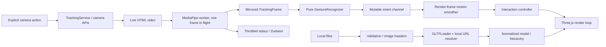

# Architecture

MONDAY is a browser-only Vite application. No application server handles user models or camera frames.

## Ownership and interfaces

`TrackingService` owns its video, stream tracks, request generation, inference scheduler, worker or main-thread landmarker, and recognizer. Creating the service does not request permission. Async work checks a session token; a stream granted after cancellation is stopped. Worker initialization has a timeout. An unresponsive in-flight detection stops the service after five seconds. Closing tracking terminates the worker or closes the landmarker and stops every stream track.

`TrackingFrame` contains up to two arrays of 21 normalized landmarks, detector handedness labels and their classification scores, timestamp, and measured inference duration. Handedness score is explicitly **not** treated or displayed as landmark confidence. MediaPipe's actual detection, presence, and tracking threshold options are each 0.65; the UI presents presence/status, not invented confidence percentages.

The worker uses the module WASM loader. The main-thread fallback uses the classic loader because the runtime loads a script element on the main thread. Both are copied from the pinned package. CPU inference in a worker avoids contention with the Three.js graphics context. OffscreenCanvas/ImageBitmap capability checks, initialization failure, and timeout lead to the fallback. There is no guaranteed universal worker support.

`GestureRecognizer` imports neither React nor Three.js. A frame and sensitivity/smoothing settings produce a `GestureOutput`: active and pending state, relative dx/dy, logarithmic zoom change, optional normalized pointer, and timestamp. Tests construct landmark sequences; no fixtures are used by production.

The mutable `trackingChannel` stores only the latest frame and intent plus a sequence counter. The viewer consumes an intent at most once and rejects stale input. MotionSmoother distributes its delta across render frames without maintaining a velocity; release and interruption clear all residual movement. Zustand stores low-frequency UI/model state. It does not carry per-render landmark updates. UI diagnostics publish about every 160 ms or on a gesture transition.

## Scheduling and no-drift behavior

One requestAnimationFrame loop schedules inference only for a new decoded video frame, at up to 30 starts/second in the worker and 24 starts/second on the main thread. The interval also scales with measured inference cost. The worker path transfers one ImageBitmap and closes it after use. A busy flag prevents overlap and avoids queued frames. The fallback calls the synchronous detector directly with its lower scheduling cap to leave more time for rendering. No assumption is made about webcam frame rate.

A hidden document clears intent and suspends inference. Camera tracks remain active until explicitly disabled. Frames older than 180 ms are discarded. At 200 ms without fresh tracking, the service clears presence and intent. Active gesture deltas are discarded immediately on release or missing landmarks; there is no persistent velocity. Mouse drag takes precedence, and dialogs suppress model manipulation. Reset and camera framing force recognizer reacquisition.

## Models and rendering

Preflight checks the GLB header, GLTF asset version, declared geometry memory, resource URIs, node cycles/parent reuse/depth, and supported compression. PNG/JPEG/WebP headers are checked before image decoding. Post-load bounds, actual geometry, and texture counts enforce additional budgets. A loading manager maps only supplied local dependencies to object URLs. Every created object URL is revoked in a finally block.

Three.js may sanitize object names for animation bindings. The inspector displays the original `userData.name` retained by GLTFLoader, falling back to the object name. UUIDs identify objects; labels are never inferred from shape. Metadata is rendered as plain text.

The loaded scene is placed inside a centering/scaling group and then a root interaction group. Uniform scale preserves proportions and original mesh transforms. Original positions support deterministic demo explosion. Source dimensions remain available independently of display scale. The entire model moves; selection is for inspection.

The viewer owns installed model GPU resources. On replacement/unmount it disposes unique geometries, materials, textures, and ImageBitmaps. Cancelled loads are also disposed. Invalid imports leave the previous model installed. Shader/environment resources have independent cleanup. A generated RoomEnvironment supplies local lighting without HDR downloads.

OrbitControls provide mouse/touch input with damping disabled, so releases stop immediately. A camera-linked Drei gizmo supports orientation. Selection uses real raycasting and a bounding-box highlight that preserves source materials. The gesture raycaster ignores hidden ancestor chains. Camera distance is bounded from 2.6 to 28 normalized scene units.

## Tradeoffs

The main-thread fallback can affect rendering on slower devices. Model parsing and initial asset decoding remain on the main thread; limits reduce but cannot remove stalls. No claims of measured real-webcam throughput or gesture accuracy are made. A conservative interaction approach favors disengagement over unintended movement. Model and tracking state are ephemeral. Only the light/dark theme preference is saved in localStorage; storage failures fall back to a session-only choice. Sidebar transitions preserve camera orientation and model transforms.
