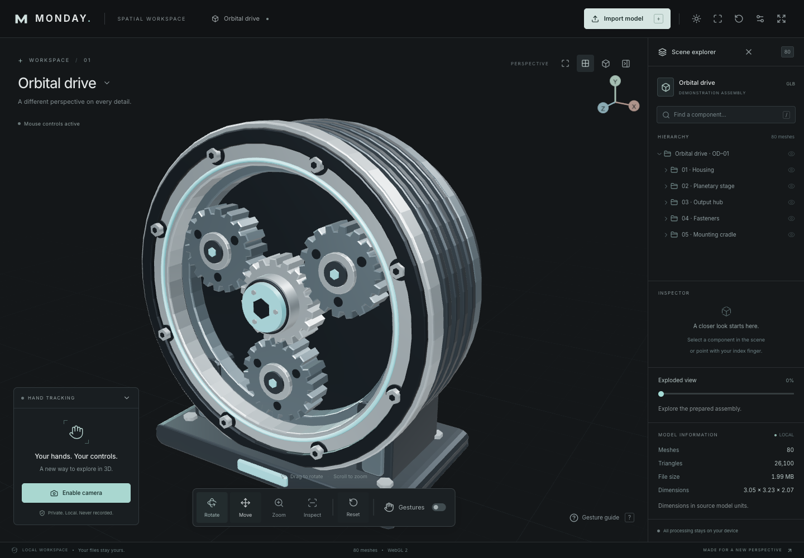

# M.O.N.D.A.Y.

**Motion-Operated Navigation, Design & Analysis sYstem.**

_The future of 3D interaction is in your hands._

An open-source spatial workspace for exploring 3D models with an ordinary webcam. Import a model, inspect its components, and use deliberate hand gestures to rotate, move, and zoom. Everything runs in your browser.



## In the workspace

- Real GLB and GLTF import, local dependency resolution, drag and drop, uniform normalization, automatic framing, and material preservation.
- An original, MIT-licensed orbital drive with 80 named meshes, 26,100 triangles, and a prepared exploded view.
- MediaPipe Hand Landmarker detects up to two hands with 21 landmarks each. Processing runs in a worker where supported, with a scheduled main-thread fallback.
- A pure TypeScript gesture state machine with temporal entry gates, pinch hysteresis, smoothing, conflict arbitration, discontinuity rejection, and immediate disengagement.
- Scene hierarchy, component search, real metadata, visibility toggles, selection bounds, wireframe, model statistics, camera framing, and full reset.
- Light/dark themes with a saved preference, retractable scene explorer, and focus mode (F) that keeps the camera preview visible.
- Adaptive hand-position filtering, render-frame gesture easing, smooth explosion transitions, and pinch feedback in the camera overlay.
- Mouse and touch orbit/pan/zoom, keyboard shortcuts, a live camera preview with landmark overlay, gesture setup, and sensitivity controls.
- No login, database, API key, model uploads, camera recording, analytics, or application backend.

This is a model viewer, not a CAD editor. Imported animation playback, mesh editing, measurement tools, and general-purpose exploded views are outside the current release.

## Run locally

Use Node.js **22.12+** (Node 24 recommended) and npm.

```sh
npm ci
npm run dev
```

Open the URL printed by Vite. The application opens directly into the workspace; camera access begins only when you choose **Enable camera** or **Gestures**.

`npm ci` copies MediaPipe WASM assets from the pinned npm package and downloads the version 1 hand model from Google's model storage. Its SHA-256 is checked. These generated files are ignored by Git and self-hosted in production. Installation needs internet access; ordinary application operation makes no third-party runtime requests. To retry asset setup:

```sh
npm run assets:tracking
```

No environment variables are required. A fresh clone includes the demonstration GLB; regenerate it with `npm run assets:demo` if you modify its original procedural source.

## Gesture reference

Keep your whole hand in frame, in even light, about an arm's length from the camera. Use **Gesture guide → Set up gesture controls** for the interactive positioning check.

| Gesture                                     | Action                                                    | Release                               |
| ------------------------------------------- | --------------------------------------------------------- | ------------------------------------- |
| One open palm                               | Hold briefly, then move horizontally/vertically to rotate | Relax your fingers or lower your hand |
| One thumb–index pinch                       | Hold briefly, then move to translate in the viewing plane | Separate thumb and index              |
| Two thumb–index pinches                     | Spread hands to zoom in; bring them together to zoom out  | Release either pinch                  |
| Index finger extended, other fingers folded | Aim the projected pointer and dwell on a mesh to inspect  | Relax or lower your hand              |
| Neutral pose or no hand                     | No transformations                                        | —                                     |

Two visible hands suppress one-hand manipulation. Only two intentional pinches engage zoom. The preview is mirrored; pointer and movement coordinates are mirrored once to match it. Closing the preview leaves tracking active. **Escape** immediately stops camera tracks, including while a dialog is open.

| Mouse / keyboard              | Action                                                    |
| ----------------------------- | --------------------------------------------------------- |
| Left drag / one-finger touch  | Orbit (Rotate mode)                                       |
| Right drag / two-finger touch | Pan                                                       |
| Wheel / touch pinch           | Zoom                                                      |
| Move tool + left drag         | Pan camera                                                |
| Zoom tool + left drag         | Dolly camera                                              |
| Click a mesh or hierarchy row | Select a component                                        |
| R / M / Z / I                 | Choose a mouse tool                                       |
| 0                             | Reset model, camera, visibility, wireframe, and explosion |
| F                             | Toggle focus mode; keep the object and camera visible     |
| /                             | Open the scene explorer and search components             |
| ?                             | Open guide                                                |
| Escape                        | Turn camera off                                           |

Gesture move translates the whole imported model. Selection identifies a component for inspection; it does not detach or drag individual parts.

## Supported files

Prefer a self-contained **GLB (GLTF 2.0)**. For **GLTF**, select or drop exactly one `.gltf` file together with every referenced `.bin`, PNG, JPEG, and WebP file. When file pickers flatten folders, dependency filenames must be unique. For ambiguous filenames or parent-relative paths, export a self-contained GLB. ZIP files and dropped directories are not unpacked.

External HTTP/HTTPS, file, and parent-directory resource paths are blocked. Missing dependencies produce an actionable error while preserving the current model. Draco, Meshopt, and KTX2 compression are explicitly rejected; re-export uncompressed. Static geometry from animated models is viewable; animation playback is not provided.

Limits: 50 MiB per file, 100 MiB total, 128 files, 512 meshes, 3,000 nodes, 2 million vertices, 1 million triangles, 8,192-pixel texture dimensions, and 64 megapixels of combined image data. Geometry memory and hierarchy limits are also checked. Image headers are inspected before decoding. These safeguards reduce risk; loading untrusted complex graphics can still stress a browser.

Dimensions are reported in source model units. Part names and metadata come from the file; MONDAY does not infer part semantics. Only the prepared demo has authored explosion directions.

## Stack and architecture

React 19, strict TypeScript, Vite 8, Three.js, React Three Fiber, Drei, MediaPipe Tasks Vision, Tailwind CSS 4, Lucide React, and Zustand. Vitest, React Testing Library, Playwright, ESLint, and Prettier provide verification.

```text
src/
  app/                       Workspace orchestration and keyboard/drop handling
  components/                Camera preview, dialogs, shared controls, error boundary
  engine/
    camera/                  Permission requests, errors, stream cleanup
    tracking/                MediaPipe initialization, worker, scheduler, live channel
    gestures/                Framework-independent temporal gesture recognizer
    interactions/            Camera-space intent → Three.js transforms and raycasting
  features/
    model-import/            Preflight, textures, GLTF resolution, normalization, disposal
    model-viewer/            R3F scene, lighting, mouse controls, camera-linked gizmo
    model-inspection/        Object hierarchy and metadata
  stores/                    Low-frequency workspace state
  styles/                    Design system and responsive layout
  tests/                     Test setup and synthetic hand fixtures
public/
  models/                    Original demo GLB and its license
  mediapipe/                 Generated, self-hosted runtime assets
  licenses/                  Third-party license texts
scripts/                     Asset generation and verified tracking setup
tests/e2e/                   Production-browser acceptance tests
docs/                        Architecture, gestures, QA, privacy, troubleshooting, deployment
```

Tracking frames live outside React. UI summaries update at roughly six times per second or on a gesture transition. The R3F frame loop consumes each intent once; gestures do not accumulate momentum. Read [architecture](docs/architecture.md) and [gesture design](docs/gestures.md).

## Browser and hardware

A current desktop browser with WebGL 2, WebAssembly, and camera APIs is required. HTTPS is required outside localhost. Desktop Chrome/Chromium is the automated browser target. Safari, Firefox, and Edge are intended targets but require their own release testing, particularly the worker fallback and camera permissions.

A webcam is optional for viewing. A modern laptop, a well-lit face-on camera, and adequate space for two hands are recommended. Touch controls and a collapsible inspector support small screens; hand interaction is most practical on desktop. No constant frame-rate or hardware performance claim is made. Inference is capped at 30 starts/second in the worker and 24 on the main thread, with additional backoff based on inference cost, and adapts naturally to available decoded frames; the UI reports measured inference time and detection rate.

## Privacy

Files are read using browser File APIs and retained only in memory. Camera frames are processed locally and are never recorded or sent to a server. Tracks stop when disabled, on Escape, or when the app unmounts. Hidden tabs suspend inference; disabling the camera releases the device. Reloading loses the current import and gesture settings. The theme preference is saved locally.

The hosting provider receives normal requests for application assets, not models or video. The build machine downloads npm packages and the fixed MediaPipe model. Runtime JavaScript, WASM, fonts, and the demo are served from the same origin. See [privacy and security](docs/privacy.md) and [third-party notices](THIRD_PARTY_NOTICES.md).

## Quality checks

```sh
npm run typecheck
npm run lint
npm run format:check
npm run test:unit
npm run build
npx playwright install chromium
npm run test:e2e
# Or unit tests + production build + browser tests:
npm test
```

On macOS with Google Chrome installed, the browser tests use it; otherwise they use Playwright Chromium. Browser tests exercise the production build on port 4173. Tests may use synthetic landmarks, permission mocks, and Chromium's synthetic camera; production never uses them. The real MediaPipe runtime is exercised with the synthetic test camera. This does not replace physical hand-gesture testing. See [verification and manual acceptance](docs/testing.md) for the recorded results and remaining release checks.

## Deploy to Vercel

Push the repository to your Git host, import it into Vercel, and use the included `vercel.json`. Installation is `npm ci`, build is `npm run build`, and output is `dist`. Select Node 24. No environment variables, functions, database, or paid backend are required. [Deployment instructions](docs/deployment.md) include production checks and security headers.

## Limits and next steps

Gestures can be affected by lighting, occlusion, motion blur, hand orientation, and detector handedness changes. These cause safe disengagement and reacquisition. Initial tracking downloads are substantial (the hand model is about 7.8 MB plus WASM); the first camera start may take several seconds. Heavy GLTF parsing still happens on the main thread. Very slow inference is discarded to avoid applying stale movement.

Future work: physical usability studies across devices and hand shapes, worker-based model parsing, optional compressed-model decoders, camera device selection, and richer accessible model navigation. No component semantics, engineering accuracy, or universal tracking reliability is claimed.

## Contribute and license

Read [CONTRIBUTING](CONTRIBUTING.md), [CODE_OF_CONDUCT](CODE_OF_CONDUCT.md), and [SECURITY](SECURITY.md). Source code and the original demonstration model are MIT licensed. Third-party dependencies retain their own licenses; see [LICENSE](LICENSE) and [THIRD_PARTY_NOTICES](THIRD_PARTY_NOTICES.md).
