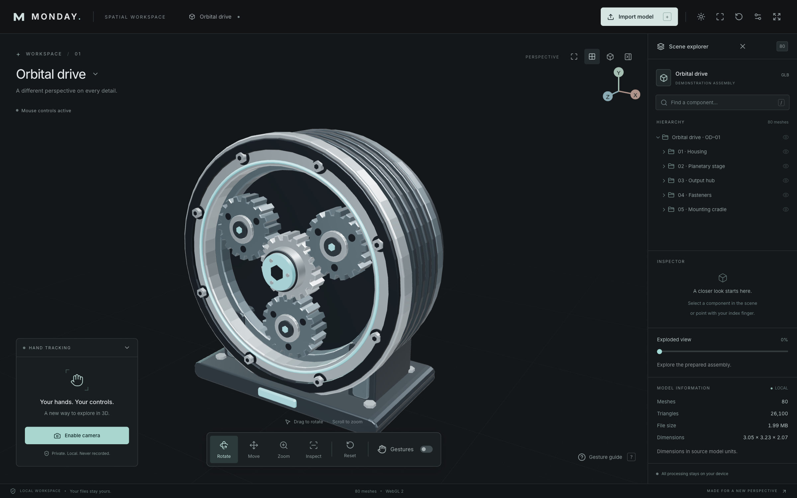
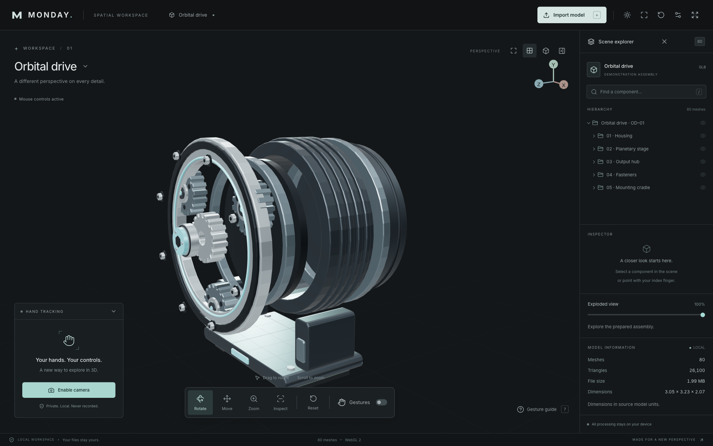
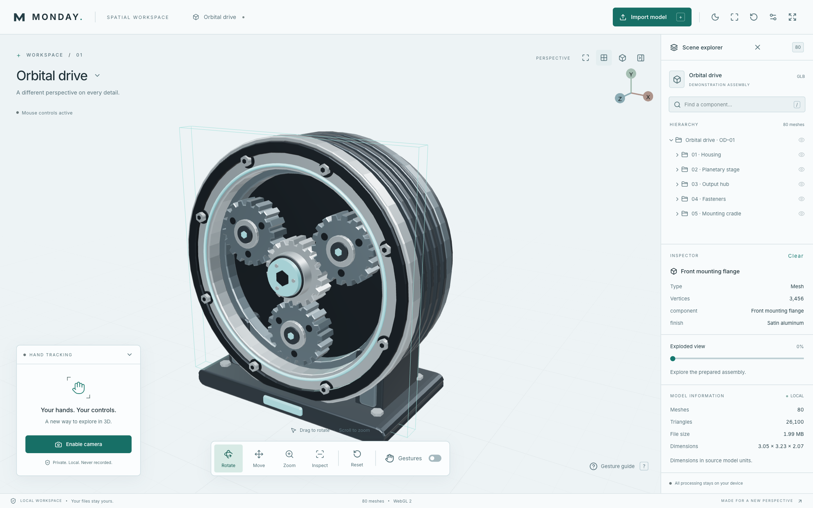
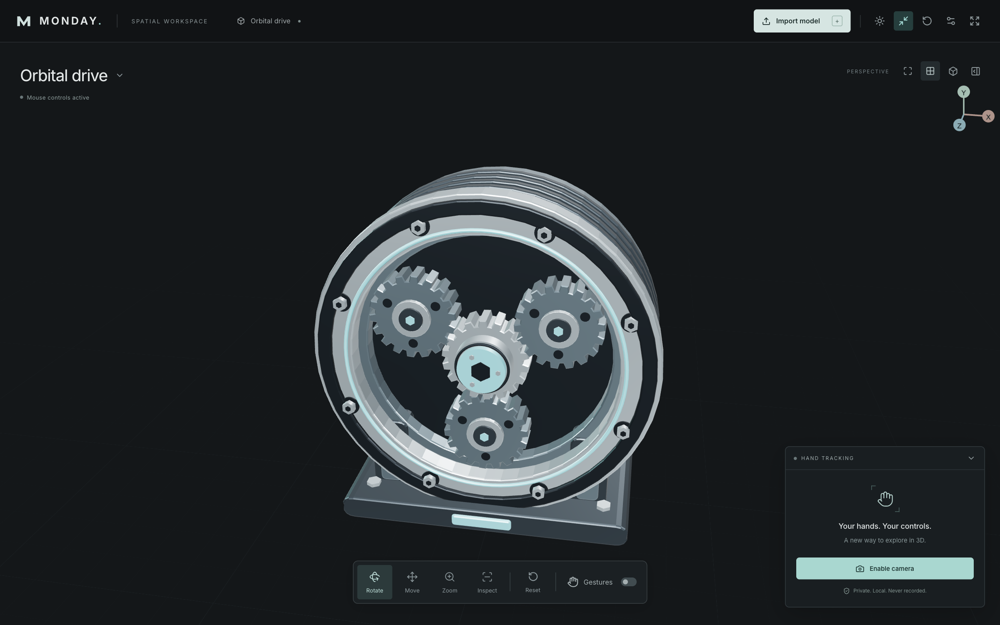
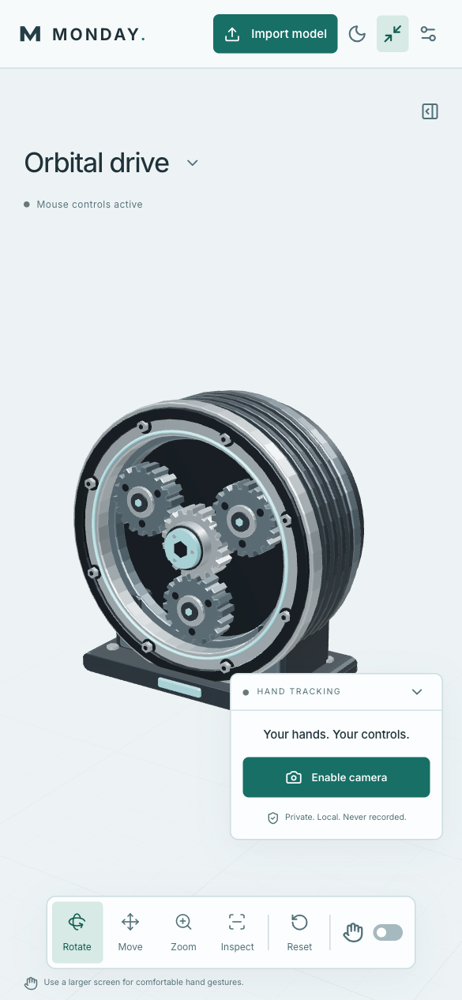

<div align="center">


# M.O.N.D.A.Y.

**Your hands. Your model. Your workspace.**

Motion-Operated Navigation, Design & Analysis sYstem.

An open-source spatial workspace that puts 3D models at your fingertips.<br />
Import an assembly. Explore its parts. Move it with your hands.

**3D in your browser · Webcam gestures · Local processing · MIT licensed**

[Get started](#get-started) · [Take a look](#take-a-look) · [Model formats](#bring-your-own-model) · [Gesture controls](#put-your-hands-to-work) · [Documentation](#under-the-hood)

</div>



<p align="center"><sub>The workspace, running in the browser. An original 80-part assembly. A new perspective on every detail.</sub></p>

## A workspace that moves with you

| Explore                                                                                                   | Manipulate                                                                                      | Make it yours                                                                                            |
| --------------------------------------------------------------------------------------------------------- | ----------------------------------------------------------------------------------------------- | -------------------------------------------------------------------------------------------------------- |
| Import GLB and GLTF models. Search the hierarchy, toggle component visibility, and inspect real metadata. | Rotate with an open palm, move with a pinch, and zoom with two hands. Mouse and touch work too. | Switch between dark and light mode. Retract the inspector. Press **F** to focus on the model and camera. |

Hand movement uses adaptive filtering and smooth transitions between tracking updates. Releasing a gesture stops manipulation. The included orbital drive also has a smoothly animated exploded view, so you can look inside the assembly.

**No account. No API key. No model uploads.** Camera frames and imported files stay in your browser.

## Get started

Use **Node.js 22.12+** and npm. Node 24 is recommended.

```sh
npm ci
npm run dev
```

Open the local URL printed by Vite. The demo model loads automatically. Drag to rotate, scroll to zoom, or choose **Enable camera** to try gestures.

Installation downloads and verifies the MediaPipe hand model and copies its runtime assets. After setup, the application serves its models, fonts, and tracking assets from the same origin. No environment variables or application backend are needed.

## Bring your own model

Click **Import model**, or drop your files into the workspace.

| Format                   | What to select                                                                                                           |
| ------------------------ | ------------------------------------------------------------------------------------------------------------------------ |
| **`.glb` — recommended** | A self-contained GLB file, with geometry, materials, and textures packaged together.                                     |
| **`.gltf`**              | One GLTF file **plus all of its referenced `.bin` files and PNG, JPEG, or WebP textures**. Select or drop them together. |

**Limits:** 50 MiB per file, 100 MiB total, up to 128 files. Additional geometry and texture limits are listed in the [platform reference](docs/reference.md#supported-files).

OBJ, STL, FBX, Blender files, and ZIP archives cannot be imported directly. Export an **uncompressed GLB** from your modeling tool first. Draco, Meshopt, and KTX2 compression are not supported. Imported models are displayed as static geometry; animation playback and mesh editing are not included.

## Take a look

### Every part, in perspective

Separate the demo assembly with the **Exploded view** slider. Orbit around the housing, gears, fasteners, and hub, then bring everything back together.



_The original demo includes authored separation paths. Arbitrary imported models do not automatically gain an exploded view._

### Light on the interface. Close on the details.

Use the sun/moon button to change the entire workspace, including the 3D background and grid. Select a component to inspect its name, geometry, and file metadata. Your theme choice is remembered locally.



### Clear the stage

Press **F**, or use the focus button in the top bar, to retract the inspector and keep the model and camera panel in view. The current orientation and relative zoom are preserved. The scene explorer also has its own retract button.



<table>
<tr>
<td width="35%" align="center">

</td>
<td>
<h3>A smaller screen. The same workspace.</h3>
<p>Touch controls, responsive framing, a retractable inspector, and light mode keep the model accessible on narrow screens.</p>
<p>Desktop gives your hands more room for webcam gestures. A camera is optional for viewing and inspecting models.</p>
<p><strong>All five screenshots show the running application and its bundled model.</strong> No interface mockups or generated product imagery.</p>
</td>
</tr>
</table>

## Put your hands to work

Enable the camera, keep your whole hand in frame, and use **Gesture guide → Set up gesture controls** for a positioning check.

| Your gesture                    | The response                                                    |
| ------------------------------- | --------------------------------------------------------------- |
| **Open palm**                   | Hold briefly, then move horizontally or vertically to rotate.   |
| **Thumb–index pinch**           | Hold briefly, then drag to move the model in the viewing plane. |
| **Two pinches**                 | Spread your hands to zoom in; bring them together to zoom out.  |
| **Point with one index finger** | Aim the pointer at a component and dwell to select it.          |
| **Relax or lower your hand**    | Stop manipulation.                                              |

Tracking supports two hands, with 21 landmarks per hand. The preview is mirrored, with landmark and pinch feedback. Adjust **Sensitivity** and **Motion smoothing** in workspace settings.

Two visible hands engage zoom only when both are pinching. Closing the camera preview keeps tracking active; **Escape turns the camera off immediately**. Gesture movement translates the whole model, while selection identifies a component for inspection.

### Prefer a mouse?

| Control                       | Action                                                        |
| ----------------------------- | ------------------------------------------------------------- |
| Left drag / one-finger touch  | Orbit in Rotate mode                                          |
| Right drag / two-finger touch | Pan                                                           |
| Wheel / touch pinch           | Zoom                                                          |
| Click a mesh or hierarchy row | Select a component                                            |
| **R / M / Z / I**             | Rotate / Move / Zoom / Inspect tool                           |
| **F**                         | Enter or leave focus mode                                     |
| **/**                         | Open the scene explorer and search components                 |
| **0**                         | Reset the model, camera, visibility, wireframe, and explosion |
| **?**                         | Open the gesture guide                                        |
| **Escape**                    | Turn the camera off                                           |

## Under the hood

**React · TypeScript · Three.js · React Three Fiber · MediaPipe · Zustand · Vite**

Hand detection runs in a worker where supported, with a scheduled main-thread fallback. Tracking data stays outside React; the render loop turns measured gesture changes into smooth model movement. The interface uses a local font, and the 3D scene uses locally generated studio lighting.

| Read more                                  | What's inside                                                    |
| ------------------------------------------ | ---------------------------------------------------------------- |
| [Architecture](docs/architecture.md)       | Tracking, rendering, data flow, and resource ownership           |
| [Gesture design](docs/gestures.md)         | Recognition rules, smoothing, arbitration, and release behavior  |
| [Platform reference](docs/reference.md)    | File limits, project structure, browser requirements, and checks |
| [Demo model](docs/demo-model.md)           | Original geometry, authored explosion paths, and MIT license     |
| [Privacy](docs/privacy.md)                 | Camera and file handling                                         |
| [Troubleshooting](docs/troubleshooting.md) | Camera, loading, and browser problems                            |
| [Deployment](docs/deployment.md)           | Hosting the static application on Vercel                         |

A current browser with WebGL 2 and WebAssembly is required. Camera access needs HTTPS or localhost. Real-world gesture quality depends on lighting, hand visibility, camera latency, and hardware; automated tests do not replace physical webcam testing.

## Development

```sh
npm run test:unit       # Recognition, interaction, camera, and import checks
npm run build           # Type-check and build the production app
npm run test:e2e         # Browser acceptance tests
npm run lint            # ESLint
```

Browser checks use installed Google Chrome on macOS, or Playwright Chromium elsewhere. Install Chromium with `npx playwright install chromium` if needed.

### Refresh the screenshots

```sh
npm run docs:screenshots
```

This builds the app, starts a temporary preview on port **4175**, and captures five real interface states into [`docs/screenshots`](docs/screenshots). The script shuts down its browser and preview server when finished. It does not enable the webcam. See the [capture script](scripts/capture-screenshots.mjs).

## Contribute

Read the [contribution guide](CONTRIBUTING.md), [code of conduct](CODE_OF_CONDUCT.md), and [security policy](SECURITY.md).

Source code and the original orbital-drive model are [MIT licensed](LICENSE). Dependencies retain their own licenses; see [third-party notices](THIRD_PARTY_NOTICES.md).

---

<p align="center"><strong>M.O.N.D.A.Y.</strong><br /><sub>The future of 3D interaction is in your hands.</sub></p>
